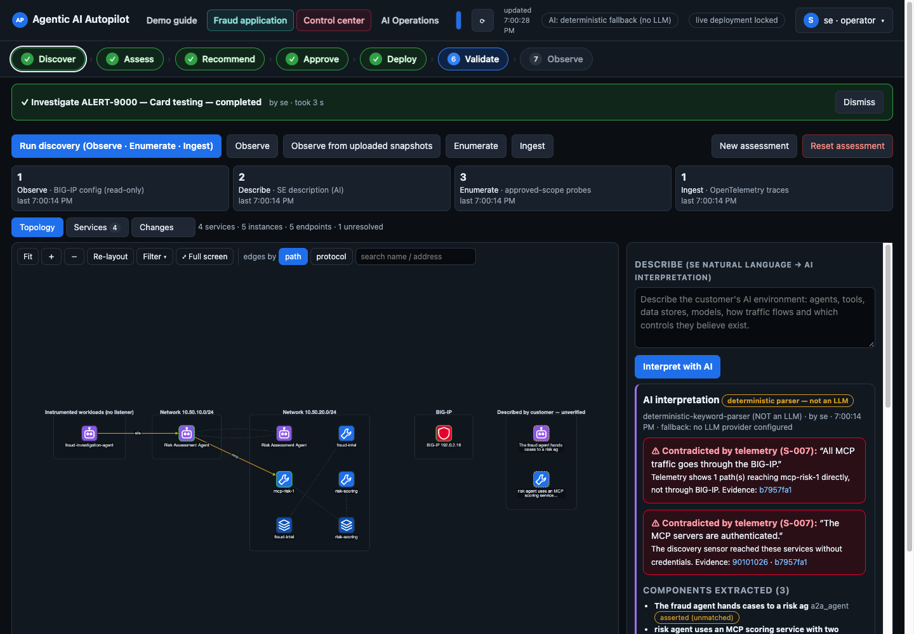
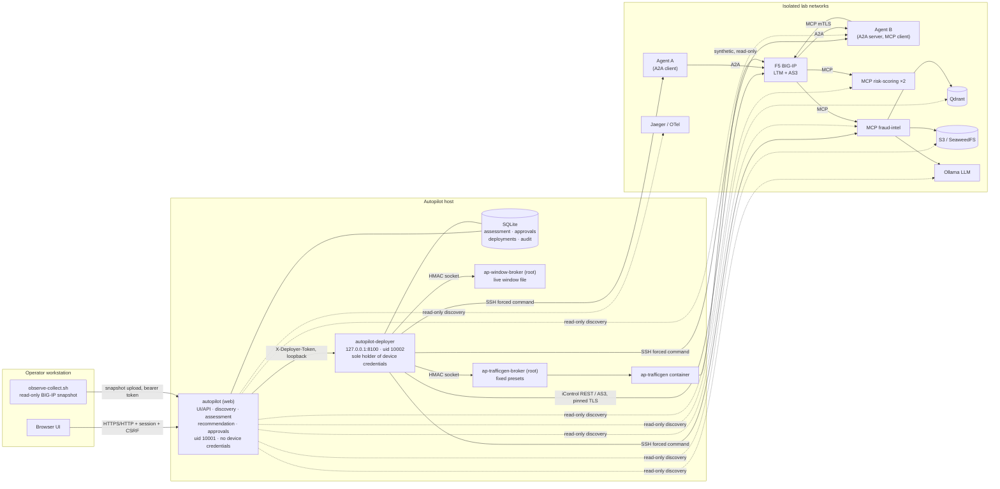
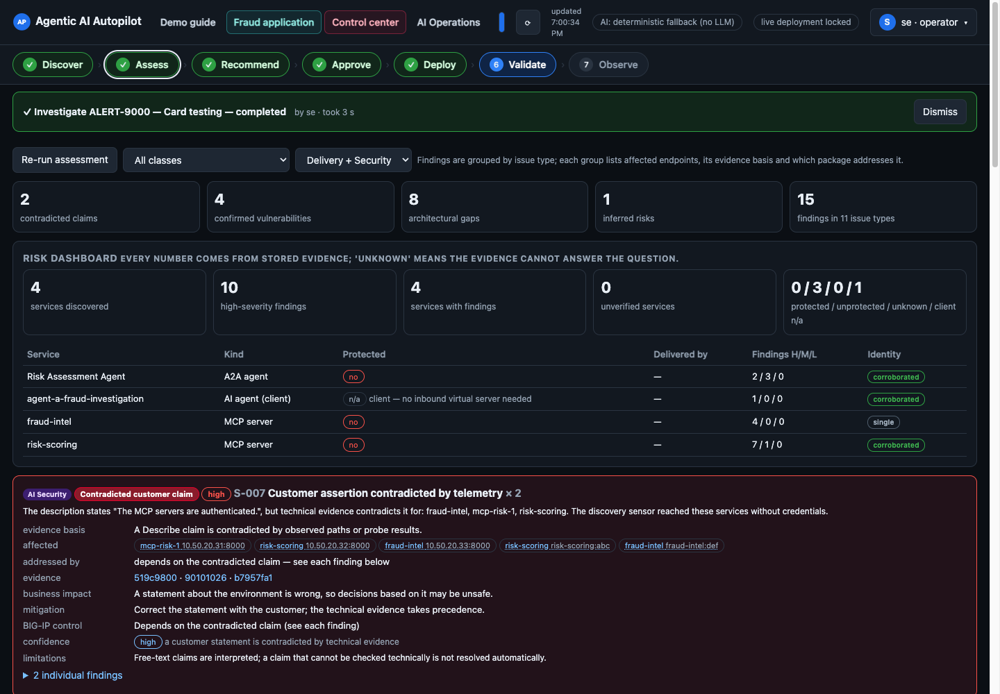
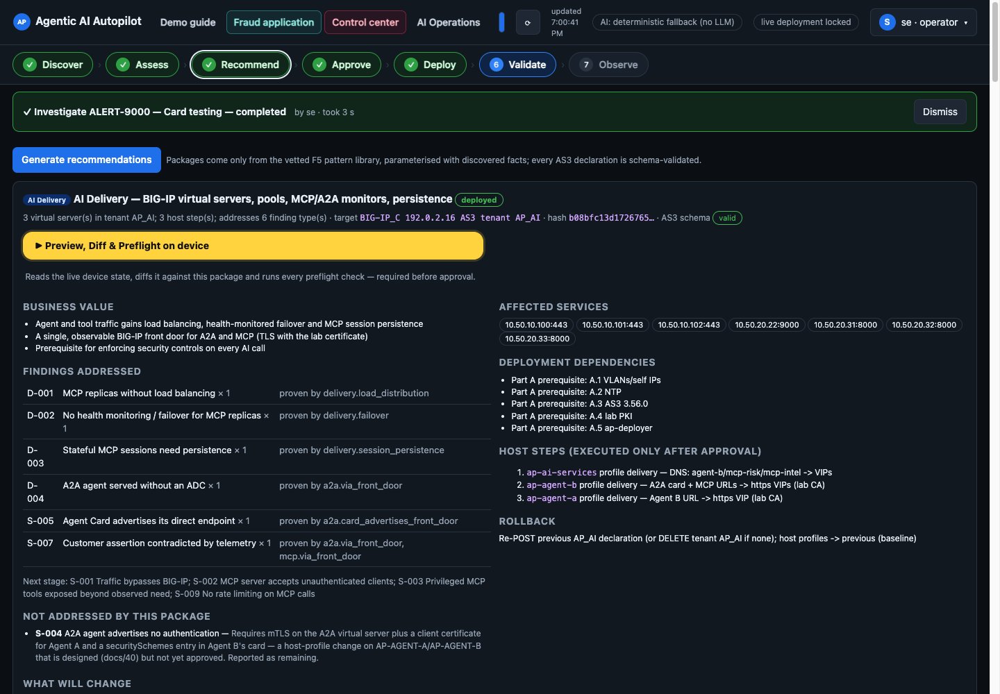
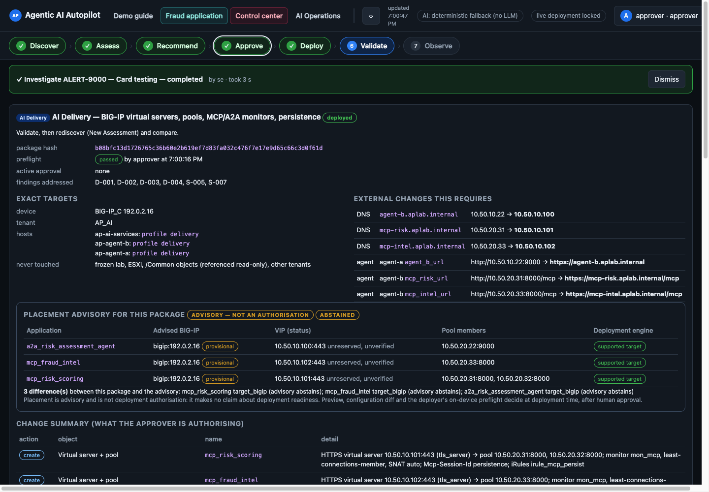
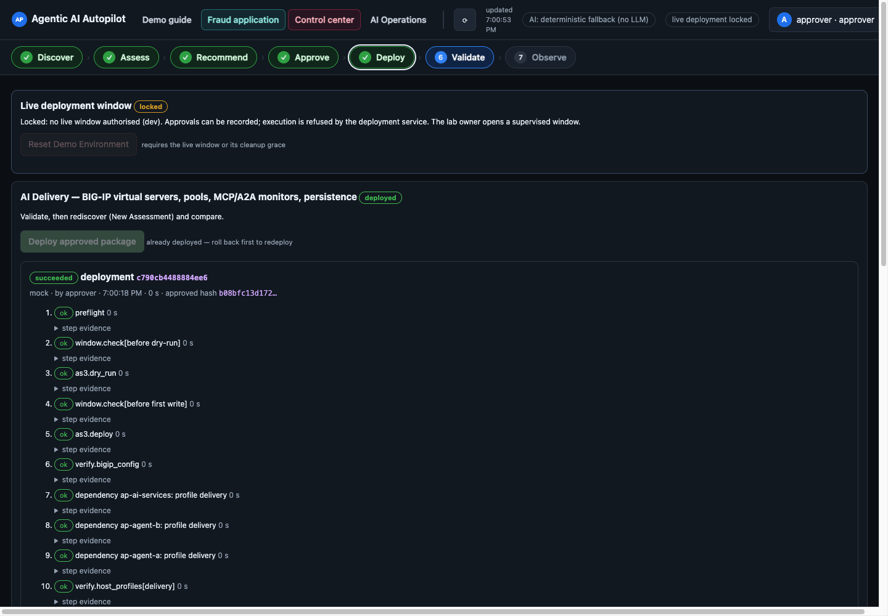
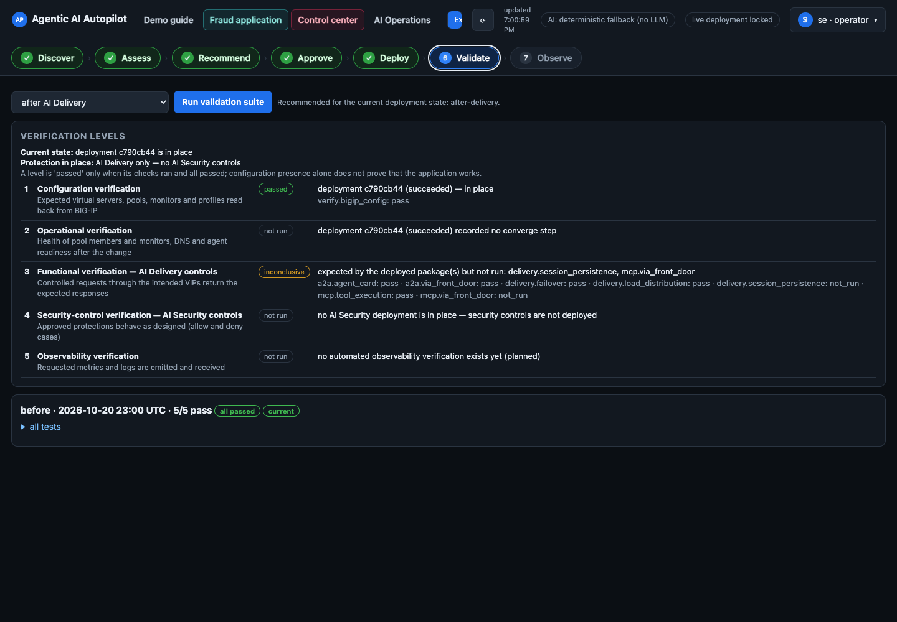
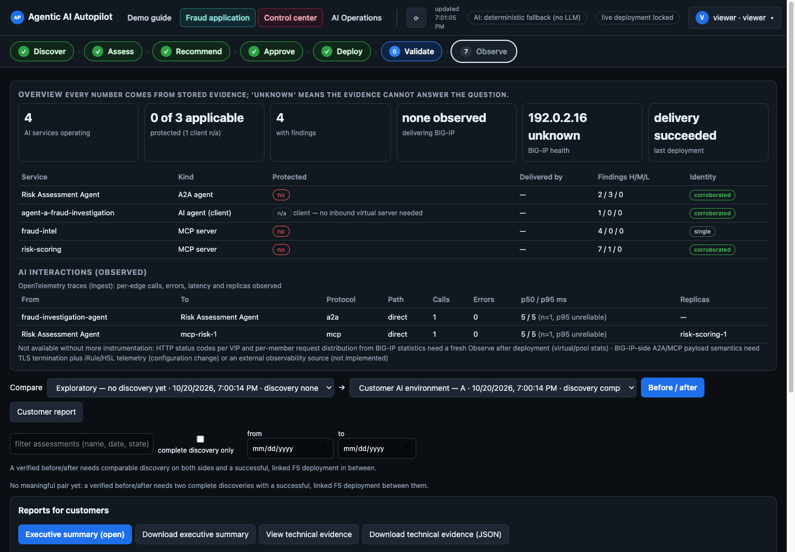
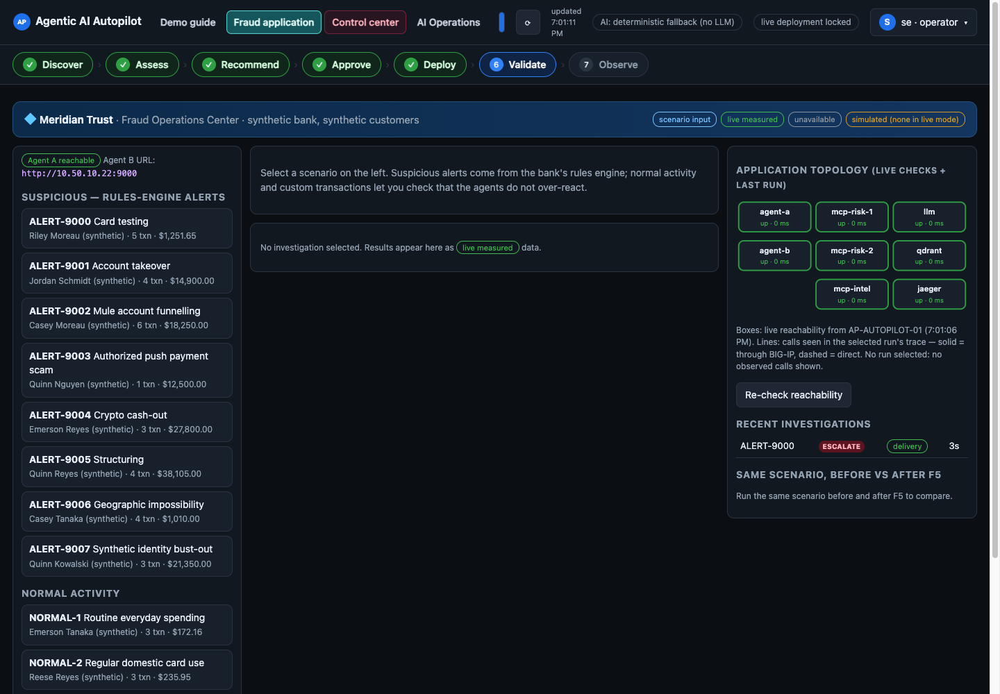
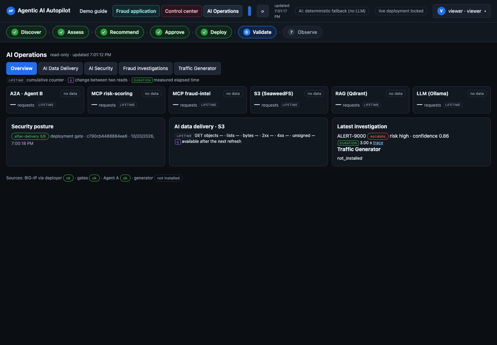

# Agentic AI Autopilot for F5 BIG-IP

**Discover an agentic-AI application, assess how it is delivered and secured, and turn the findings into reviewed,
human-approved, validated and reversible F5 BIG-IP configuration.**

> **Independent project — not an official F5 product.** "F5" and "BIG-IP" are trademarks of F5, Inc. They are used
> here only to describe compatibility. F5 does not endorse or support this project. It is a lab prototype built for an
> AI competition submission. It is not production software.



---

## Contents
1. [Problem](#problem) · 2. [Capabilities](#capabilities) · 3. [Architecture](#architecture) ·
4. [Seven-stage workflow](#the-seven-stage-workflow) · 5. [Agents, MCP and A2A](#ai-agents-mcp-and-a2a) ·
6. [AI Data Delivery and AI Security](#ai-data-delivery-and-ai-security) ·
7. [Deterministic vs LLM-assisted](#deterministic-vs-llm-assisted-functionality) ·
8. [Safeguards](#deployment-and-approval-safeguards) · 9. [Prerequisites](#prerequisites) ·
10. [Quick start](#quick-start) · 11. [Configuration](#configuration) · 12. [Login and first-run setup](#login-and-first-run-account-setup) ·
13. [Demo walkthrough](#demo-walkthrough) · 14. [Screenshots](#screenshots) · 15. [Tests](#test-and-validation) ·
16. [Security](#security-considerations) · 17. [Limitations](#known-limitations) · 18. [Troubleshooting](#troubleshooting) ·
19. [Project structure](#project-structure)

## Problem
Agentic-AI applications combine agents (A2A), tool servers (MCP), vector databases, object stores and model endpoints.
Teams often deploy them without an application delivery controller. The result:
- MCP replicas without load balancing or health monitoring;
- stateful MCP sessions without persistence;
- agent cards that advertise direct back-end addresses, so traffic bypasses the proxy;
- unauthenticated MCP servers and privileged tools exposed to every client;
- no rate limiting.

Fixing this with BIG-IP is well understood but manual. You have to find what exists, prove each gap with evidence,
write correct AS3, change DNS and agent configuration, and show afterwards that the change actually worked.

Autopilot automates that loop. Every infrastructure change stays behind an explicit human approval and a time-bounded
live window.

## Capabilities
| Area | What is implemented |
|---|---|
| Discovery | Read-only BIG-IP **Observe** (live REST GETs or uploaded snapshots); **Enumerate** of an approved CIDR/host scope (A2A agent cards, MCP `initialize`/`tools/list`, Qdrant, S3, Ollama, OTLP, DNS zone transfer); **Ingest** of OpenTelemetry traces from Jaeger; **Describe**: an engineer's natural-language description, interpreted into *asserted* (unverified) components |
| Assessment | Evidence-backed findings catalogue (D-001…D-006 delivery, S-001…S-009 security) with a status for each finding: confirmed, inferred, contradicted, or not assessable |
| Recommendation | Change packages generated from **vetted templates**: AI Delivery, AI Security, AI Data Delivery (AS3 declarations + iRules + host dependency plan), plus an advisory BIG-IP placement analysis |
| Approval | Hash-bound approvals: package SHA-256 + device fingerprint + expiry, approver role, mandatory preview/diff/preflight review |
| Deployment | Separate, privileged deployer service: approval re-verification, preflight, rollback capture, AS3 dry-run and deploy, scoped host profile changes, convergence barrier, validation gate, **automatic rollback** on failure, journalled steps |
| Validation | Active tests per profile (`before`, `after-delivery`, `after-security`, `after-data`): front-door routing, load distribution, failover, persistence, mTLS identity, tool authorisation, rate limiting, data-path checks |
| Observe | Verification levels, before/after comparison of assessments, findings over time, reports (HTML / JSON) |
| AI Operations | Read-only dashboards: BIG-IP data-VIP and S3 statistics (via the deployer's observer account), deployment-gate and independent validation results, fraud-investigation execution paths from traces, Traffic Generator runs |
| Fraud demo application | Synthetic fraud-investigation workflow: Agent A → A2A → Agent B → MCP (risk scoring, fraud intel with RAG/S3) → LLM, with provenance labels (synthetic input, measured timings, illustrative scoring model) |
| Traffic Generator | Bounded, read-only synthetic traffic through the BIG-IP VIPs (fixed presets, rate caps, stop file, operator-started from the UI through a root-owned broker) |

## Architecture

More detail: [docs/ARCHITECTURE.md](docs/ARCHITECTURE.md).

## The seven-stage workflow
| # | Stage | Who | What happens |
|---|---|---|---|
| 1 | **Discover** | operator | Observe + Enumerate + Ingest (+ optional Describe). Every fact is stored as evidence with its source; assets are reconciled by canonical identity keys |
| 2 | **Assess** | operator | Deterministic rules evaluate the findings catalogue against the evidence. Customer assertions that telemetry contradicts are flagged (S-007) |
| 3 | **Recommend** | operator | Packages are built from vetted templates and the discovered facts. A placement advisory checks device evidence (advisory only, never an authorisation) |
| 4 | **Approve** | approver | Preview, diff and on-device preflight are reviewed. The approval binds the package hash, device fingerprint and an expiry |
| 5 | **Deploy** | owner + approver | The **owner** opens a time-bounded live window (password re-entry + typed confirmation). An **approver** deploys. The deployer re-verifies everything and rolls back automatically if the validation gate fails |
| 6 | **Validate** | operator | Independent validation runs prove front-door routing, distribution, failover, mTLS identity, tool authorisation and rate limiting |
| 7 | **Observe** | viewer+ | Rediscovery and comparison against the pre-change assessment, verification levels, reports, AI Operations dashboards |

## AI agents, MCP and A2A
- **Agent A** (fraud investigation, A2A client): resolves Agent B's Agent Card and delegates each alert with streaming
  `SendMessage`. It follows the URL the card advertises. That is how Autopilot detects a card that bypasses the proxy (S-005).
- **Agent B** (risk assessment, A2A server and MCP client): calls MCP tools on `mcp-risk` (two replicas) and `mcp-intel`
  (RAG over Qdrant, case documents on S3). An evidence-first deterministic classifier always runs. An LLM then writes
  the narrative assessment, falling back to a deterministic assessment when no LLM is available, and the result is
  calibrated against the classifier.
- **MCP servers** expose read-only tools (`score_transaction`, `model_info`, `list_open_alerts`, `search_fraud_patterns`, …).
  They also deliberately expose two **privileged** synthetic tools (`freeze_account`, `export_customer_data`) so
  over-exposure (S-003) can be demonstrated and then restricted.
- **AI Security on BIG-IP**: client-certificate (mTLS) identity on the MCP VIPs, plus a generated iRule that authorises
  tools per identity and rate-limits per identity (HTTP 403 / 429).
- **Autopilot itself is not an autonomous agent.** It never deploys on its own initiative. Every infrastructure change
  needs an approver session and an owner-authorised live window.

## AI Data Delivery and AI Security
- **AI Delivery package:** HTTPS virtual servers and pools for A2A and MCP, MCP/A2A health monitors, `Mcp-Session-Id`
  persistence, A2A stream timeouts, and DNS/agent repointing to the front doors.
- **AI Security package:** the Delivery content plus mTLS client authentication, per-identity tool allow-lists, a
  per-identity rate limit (`rate_limit_per_min`), and lockdown of direct back-end paths.
- **AI Data Delivery package** (opt-in, cumulative on top of Security): VIPs for S3 (SeaweedFS), RAG (Qdrant) and
  inference (Ollama), with service-specific monitors, isolated VLANs, and an *observe-only* S3 statistics iRule. That
  iRule only counts requests; it never alters traffic.

## Deterministic vs LLM-assisted functionality
| Function | Implementation |
|---|---|
| Discovery, reconciliation, findings, package generation, preflight, approvals, deployment, rollback, validation | **Deterministic code**. No LLM is involved |
| Describe (natural-language environment description) | LLM extracts *asserted* components into a strict JSON schema. Assertions stay "unverified" until technical evidence matches them. Without an LLM, a deterministic keyword parser runs and is labelled **"NOT an LLM"** in the UI |
| Agent B risk synthesis (demo application) | LLM (OpenAI-compatible endpoint such as Ollama, or Anthropic) with a labelled deterministic fallback |
| Deployment authorisation | **Humans only**: approver session + owner-opened live window. No service or LLM identity can hold a session |

LLM providers: `LLM_PROVIDER=none` (default), `openai-compatible` (`LLM_BASE_URL`, e.g. Ollama `qwen2.5:3b`), or
`anthropic` (`ANTHROPIC_API_KEY`, `LLM_MODEL`). Every LLM result records its provider and model.

## Deployment and approval safeguards
- Two services: the web service has **no device credentials**. The deployer is loopback-only, holds the credentials,
  and accepts deploy/rollback only from the exact **approver** role.
- **Two-person rule:** the owner opens a live window (1–180 minutes plus a ≤30-minute cleanup grace) through a
  root-owned broker. An approver deploys. Outside a window every write is refused.
- Approvals are bound to the package hash and the device fingerprint, expire (2 h by default), are single-use, and
  require a review less than 30 minutes old.
- Deployer policy restricts AS3 to one tenant, a class allow-list, pinned `/Common` references, and allowed VIP/member
  ranges. Host changes are limited to a fixed command allow-list run through an SSH forced command.
- Every deployment captures rollback state, runs a validation gate, rolls back automatically on failure, and verifies
  the rollback. All steps are journalled in the audit trail.

## Prerequisites
| Use | Requirements |
|---|---|
| **Simulated demo** (no hardware) | macOS or Linux, Python 3.12, a browser. Optional: Node.js ≥ 18 + Google Chrome for browser tests/screenshots |
| **Autopilot web (+ deployer)** | Linux host with Docker Engine 24+ and the compose plugin (tested design: Ubuntu 24.04 LTS, Python 3.12 slim image) |
| **Full reference lab** | F5 BIG-IP VE **21.1** (LTM) with **AS3 ≥ 3.56** and your own licence; Linux VMs for Agent A, Agent B and AI services; two isolated L2 networks; a lab PKI (CA, server and client certificates); about 8 GB RAM for Ollama with `qwen2.5:3b` and `nomic-embed-text` |

You need your **own** BIG-IP, certificates and credentials. None are included.

## Quick start
### 1. Simulated demo (offline, about 2 minutes)
```bash
git clone <this-repository> && cd f5-agentic-ai-autopilot
scripts/run-demo.sh            # creates .venv-demo, starts http://127.0.0.1:8765
# open http://127.0.0.1:8765/dev-login?u=se   (users: viewer | se | approver | owner)
```
The demo runs the **real** web application against mock BIG-IP/host executors and recorded fixtures. The
`/dev-login` shortcut exists **only** in `devtools/devserver.py`, which binds to 127.0.0.1. Never expose it.

### 2. Autopilot on a Docker host
```bash
sudo scripts/install-autopilot.sh     # creates .env, autopilot.local.yaml, secrets (0600), builds, starts
scripts/bootstrap-admin.sh            # choose YOUR owner username + password (hidden prompt)
scripts/bootstrap-admin.sh add alice approver
scripts/healthcheck.sh
```
Full instructions, including the deployer credential files and the reference lab: [docs/INSTALLATION.md](docs/INSTALLATION.md).

## Configuration
- `deploy/autopilot/.env` holds non-secret settings: bind address, paths, LLM ([`.env.example`](deploy/autopilot/.env.example)).
- `${APLAB_SECRETS}/autopilot.env` holds the session secret and deployer token, generated by `scripts/gen-secrets.sh`.
- `deploy/autopilot/autopilot.local.yaml` holds the discovery scope and BIG-IP design ([`autopilot.example.yaml`](deploy/autopilot/autopilot.example.yaml)).
- `${APLAB_SECRETS}/deployer/` holds the device credential files, which only the deployer reads.

See [docs/CONFIGURATION.md](docs/CONFIGURATION.md).

## Login and first-run account setup
No accounts and no default password ship with the project. The first account is created **locally** on the host:
`python -m autopilot.auth bootstrap`, wrapped by `scripts/bootstrap-admin.sh`.
- It prompts for your own username and password (minimum 12 characters, hidden input).
- Passwords are stored as scrypt hashes.
- Bootstrap refuses to run once any account exists, and the web API has no account-creation endpoint.
- Roles: `viewer < operator < approver < owner`.

See [docs/AUTHENTICATION.md](docs/AUTHENTICATION.md).

## Demo walkthrough
[docs/DEMO.md](docs/DEMO.md) walks through the seven stages in the simulated demo: a failed deployment that rolls back
automatically, then a successful one, validation, a fraud investigation and the AI Operations views. It also describes
the extra steps for a real lab.

## Screenshots
All screenshots come from the **simulated demo** (synthetic data, RFC 5737 / private example addresses).

| | |
|---|---|
|  Assess |  Recommend |
|  Approve |  Deploy |
|  Validate |  Observe |
|  Fraud application |  AI Operations |

## Test and validation
```bash
scripts/run-tests.sh             # Autopilot + Traffic Generator offline suites
scripts/run-tests.sh --browser   # + 41 headless-Chrome UI scenarios against the simulated demo
```
Last recorded results for this publication candidate: 552 Autopilot tests passed, 5 skipped (they need lab-only
artifacts), 30 Traffic Generator tests passed, and 41/41 browser scenarios passed. No test contacts a lab system. See
[docs/DEVELOPMENT.md](docs/DEVELOPMENT.md).

## Security considerations
- No credentials, keys, certificates or device backups are in this repository. Generate your own.
- The UI defaults to plain HTTP on 127.0.0.1. Use TLS (`TLS_CERTFILE`/`TLS_KEYFILE`) or a TLS proxy before exposing it.
- The deployer's AS3 policy and host command allow-list are the main safety boundary. Review `deployer/policy.py` for your lab.
- Report vulnerabilities as described in [SECURITY.md](SECURITY.md). Details: [docs/SECURITY.md](docs/SECURITY.md).

## Known limitations
Lab prototype. Single BIG-IP target for deployment. The reference topology is hard-coded in
`deployer/policy.py`. SQLite with a single host. No SSO. Demo data is synthetic. Full list:
[docs/LIMITATIONS.md](docs/LIMITATIONS.md).

## Troubleshooting
[docs/TROUBLESHOOTING.md](docs/TROUBLESHOOTING.md)

## Project structure
```
app/autopilot/            web application, discovery sources, assessment, packages, approvals, validation, AI Operations
app/autopilot/deployer/   privileged deployment engine, policy, executors, live-window and broker clients
app/autopilot/static/     single-page UI (vanilla JS, Cytoscape.js)
app/services/             agent_a, agent_b, mcp_risk, mcp_fraud_intel, seed (synthetic data loader)
app/aplab/                shared LLM client, synthetic data generator, OpenTelemetry helpers
app/tests/                offline test suite + fixtures
deploy/                   Dockerfile, compose files, host profiles, nftables, brokers (reference lab)
traffic-generator/        bounded synthetic workload engine, container and root broker
devtools/                 simulated dev server, browser regression suite, screenshot capture
scripts/                  install, secrets, bootstrap, health, demo, tests, Observe collector
config/                   *.example files for the Observe collector
docs/                     architecture, installation, configuration, authentication, security, demo, limitations
```

## License
**No licence has been chosen yet** (see [docs/LIMITATIONS.md](docs/LIMITATIONS.md#licensing-and-publication)). Until a
licence file is added, all rights are reserved by the author. Third-party components keep their own licences. See
[THIRD_PARTY_NOTICES.md](THIRD_PARTY_NOTICES.md).
