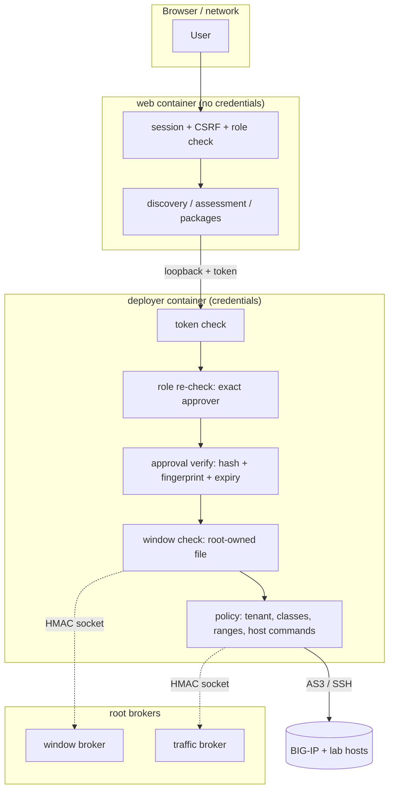
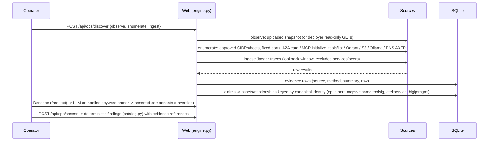
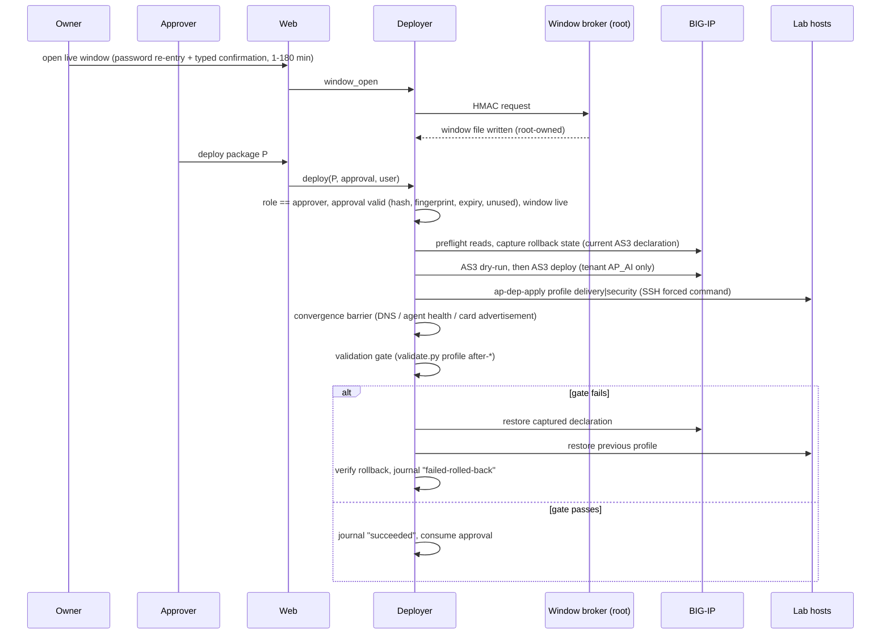

# Architecture

## Components
| Component | Code | Runs as | Responsibility |
|---|---|---|---|
| Web service | `app/autopilot/web.py` + modules | container `autopilot`, uid 10001, group apdb | UI/API, sessions, discovery (Observe snapshots, Enumerate, Ingest, Describe), assessment, recommendation, approvals, validation runs, reports, AI Operations read model. **Holds no device credentials** |
| Deployer | `app/autopilot/deployer/service.py`, `engine.py` | container `autopilot-deployer`, uid 10002, loopback `127.0.0.1:8100` | The only component that writes to BIG-IP or lab hosts: approval re-verification, preflight, AS3 dry-run/deploy, host profiles, convergence, validation gate, rollback. Also performs read-only BIG-IP reads for the web service (observer account) |
| Live-window broker | `deploy/common/ap-window-broker`, `ap-live-window` | root, Unix socket `/run/ap-window/broker.sock` | Creates / closes the root-owned window file that the deployer reads. The deployer reaches it through an HMAC-authenticated socket protocol |
| Traffic Generator broker | `traffic-generator/container/ap-trafficgen-broker` | root, socket-activated | Maps a preset id to a fixed command line, enforces one active run and hourly limits, starts/stops the `ap-trafficgen` container |
| Host helper | `deploy/common/ap-dep-apply` | `apdeploy` user via SSH forced command + sudo | Applies host profiles (`baseline` / `delivery` / `security`) on Agent A, Agent B and AI services: DNS zone, agent environment, nftables lockdown |
| Demo application | `app/services/*` | containers on lab VMs | Agent A, Agent B, MCP risk-scoring ×2, MCP fraud-intel, seed job |
| AI services | `deploy/ai-services/docker-compose.yml` | containers | Qdrant, SeaweedFS (S3), Ollama, CoreDNS, OpenTelemetry Collector, Jaeger |

The web and deployer containers share only the SQLite database (group `apdb`, gid 10010). The web service calls the
deployer over loopback with a shared token (`X-Deployer-Token`).

## Trust boundaries

## Data model (SQLite)
- **Assessment workspace:** `assessment`, `evidence`, `asset`, `asset_claim`, `rel`, `rel_claim`, `finding`, `recommendation`, `inventory_snapshot`, `inventory_change`, `discovery_schedule`.
- **Change control:** `package`, `package_review`, `approval`, `deployment` (with journalled `steps` and `previous_state`), `verified_state`, `live_window`.
- **Audit:** `audit` (append-only rows for logins, approvals, window events, deployments, refusals, maintenance CLI).
- **Operations / validation / accounts:** `operation`, `validation_run`, `fraud_run`, `rate_event`, `throttle`, `users`.

## Discovery pipeline

## Recommendation and packages
`packages.py` and `data_delivery.py` build AS3 declarations from **vetted templates** plus discovered facts: VIPs from
`design`, members from discovered endpoints, and identities from trace/OTel mapping. Packages are cumulative:
- **Delivery** creates the base.
- **Security** = Delivery plus mTLS, the tool policy iRule, the rate limit and the lockdown host profile.
- **Data** = Security plus the S3, RAG and LLM VIPs.

Each package has:
- a canonical SHA-256;
- a dependency plan (DNS / agent environment / nftables changes per host profile);
- a findings list;
- an AS3 schema validation (`packages/vendor/as3-schema-3.56.0-10.json`).

`advisory.py` / `placement.py` produce a **placement advisory**. It is never an authorisation. It abstains without
trusted device evidence.

## Deployment sequence

## AI Operations read model
`aiops.py` is read-only. Its sources:
- the deployer's read-only `data_status` / `pool_status` actions (BIG-IP statistics through the observer account);
- the deployment journal (gate validations);
- `validation_run` (independent runs);
- Agent A's investigation list and Jaeger traces (execution path per stage: A2A → MCP → embeddings → Qdrant → S3 → LLM);
- the Traffic Generator's status files (read-only bind mount).

Trace summaries are sanitised and stored as bounded JSON files.

## Network reference topology
| Segment | Example addressing | Notes |
|---|---|---|
| Management LAN | `192.0.2.0/24` (placeholder) | Autopilot UI, Agent A operator UI, Jaeger UI, BIG-IP management |
| Agent network | `10.50.10.0/24` | BIG-IP self IP `.10`, VIPs `.100`–`.105`, Agent A `.21`, Agent B `.22` |
| Backend network | `10.50.20.0/24` | BIG-IP self IP `.10`, MCP `.31/.32/.33`, Qdrant `.40`, S3 `.41`, Ollama `.45`, DNS `.53`, OTel `.63` |

These are the **documented example** values. To use your own networks, set them consistently in:
- `autopilot.local.yaml`: `design`, `enumerate`, `fraud_app`, `validation`, and the optional `deployer_policy`
  (VIP range, member range, SSH helper host addresses), which the deployer validates fail-closed at start-up;
- the lab-VM compose files and CoreDNS zone profiles under `deploy/`.

The tenant name (`AP_AI`) and the `/Common` object names remain fixed in `deployer/policy.py`.
